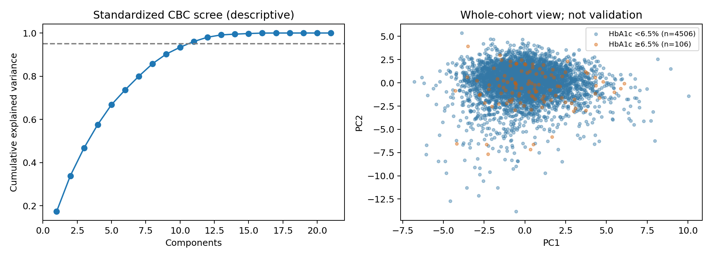

# CBC collinearity and PCA supplement — 2026-11-23

Exploratory Phase 7 supplement on the fixed 4,612 adults / 106 positive HbA1c labels.
The original primary analysis and independent-cycle results are preserved.

## Collinearity

Differential percentages sum to 100.0–100.2%
(mean 100.125%). The team's 2026-11-23 cohort-summary decision
supersedes the earlier 11-predictor block (which dropped MCH, MCHC, MPV, NRBC,
basophil % and the five absolute differential counts): all 21 CBC variables are
now kept as model features. Rounding makes the released differential sum
approximately fixed. VIFs for both the legacy 11-predictor block and the current
full 21-predictor block are exported with ordinary and survey-weighted auxiliary
regressions and an intercept, so the earlier collinearity finding can be checked
against the larger panel.
Adding back the dropped components does not remove the strong approximate
dependence among the differential percentages; high VIF persists and motivates
the PCA sensitivity arm.

Largest survey-weighted VIFs in the current full 21-predictor block:

- LBXNEPCT: weighted VIF 25982.8.
- LBXLYPCT: weighted VIF 22005.5.
- LBXEOPCT: weighted VIF 1345.2.
- LBXMOPCT: weighted VIF 1336.1.

Hematocrit approximately equals RBC × MCV / 10 (median absolute residual
0.0334 hematocrit
percentage points). Now that MCH and MCHC are themselves predictors, the same
kind of near-identity applies to them: MCH ≈ HGB × 10 / RBC (median absolute
residual 0.0578 pg) and
MCHC ≈ HGB × 100 / HCT (median absolute residual
0.0667 g/dL) — both
expected to inflate VIF further in the full 21-predictor block versus the legacy
11. High VIF does not justify causal interpretation, nor does it automatically
invalidate penalized prediction. Retain the existing regularized raw-feature
model and treat PCA as a secondary robustness comparison.

## Matched nested comparison

Both models use demographics and BMI. Only the CBC representation changes. PCA
retains 95% variance with component counts [11] across inner/outer training fits.
Scaling/PCA are unweighted; classifiers, calibration and evaluation use WTPH2YR.
Five outer / three inner PSU-grouped folds match the extension. Calibration and
95%-weighted-sensitivity thresholds use development data only.

| Model | AUROC | AP | Brier | Log loss | Deferred | Missed / 106 |
|---|---:|---:|---:|---:|---:|---:|
| demographics_bmi_cbc | 0.8107 | 0.0758 | 0.01902 | 0.08546 | 1665 | 6 |
| demographics_bmi_cbc_pca95 | 0.8141 | 0.0768 | 0.01901 | 0.08546 | 1756 | 4 |

Deferred and missed are observed counts; the development sensitivity target does
not guarantee held-out sensitivity. Conditional design intervals are exported,
but exclude refitting/split uncertainty; no superiority or clinical-safety claim
is established by this exploratory comparison. The older cycle was not reused.

## Figures and verification

The whole-cohort figure and loadings are descriptive and never enter validation.
PCA maximizes predictor variance, not outcome separation. Components/loadings are
not causal effects. Re-run `python scripts/analysis/cbc_diagnostics.py` from the root.

Checks passed for saved raw-CBC prediction reproduction, matched subjects/folds,
all 40 inner/outer fit audits, PSU separation, PCA training sample counts, and
finite unique predictions. See [validation](../verification/cbc_diagnostics_validation.json)
and [analysis specification](../methods/phase7_analysis_protocol.md).
PCA projections are checked against independent non-BLAS contractions. The local
NumPy/Apple BLAS build emitted matmul floating-point warnings despite finite,
matching results; these warnings are accepted only after that numerical check.

This supplies additional reproducible methods, a meaningful matched baseline,
variability estimates and explicit limitations for the final-project rubric.
Team review and integration with the other cohort/endpoint proposals remain open.
