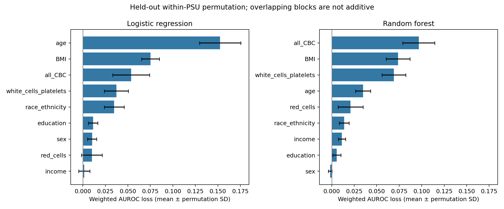

# Held-out grouped permutation importance — 2026-11-16

This completes the Phase 11 held-out interpretation task for the primary 4,612-person,
106-positive cohort. It evaluates the existing logistic and forest procedures, without
changing their features or selecting a model. Unperturbed calibrated predictions and
folds reproduce the saved extension results.

## What was measured

Each predictor block was jointly shuffled within each held-out PSU, using 20 reproducible
permutations and the same donors across models/blocks. No training records were shuffled;
preprocessing, classifiers and development-only calibrators stayed frozen. Joint CBC
shuffling preserves within-block relationships. Labels, weights and design membership stay
fixed. The five out-of-fold vectors are pooled per repeat for weighted evaluation.
Donor assignments are uniform within each PSU; weights remain attached to recipients.
This preserves the unweighted block values, not their survey-weighted marginal distribution.

The scores measure fitted-model reliance under this within-PSU perturbation. They exclude
between-PSU dependence and are not independent or causal contributions. Overlapping all-CBC,
red-cell and white-cell/platelet scores must not be added. Correlated predictors may
substitute for each other; cross-block shuffling can create unusual combinations.
Small sex/education scores, including negative values, do not establish absence of
biomedical relevance or fairness across groups. This is not a subgroup fairness test.

## Results

| Model | Block | Mean AUROC loss | Permutation SD |
|---|---|---:|---:|
| Logistic | age | 0.1525 | 0.0229 |
| Logistic | BMI | 0.0752 | 0.0098 |
| Logistic | all_CBC | 0.0536 | 0.0205 |
| Logistic | white_cells_platelets | 0.0372 | 0.0134 |
| Logistic | race_ethnicity | 0.0348 | 0.0110 |
| Logistic | education | 0.0114 | 0.0051 |
| Logistic | sex | 0.0102 | 0.0051 |
| Logistic | red_cells | 0.0100 | 0.0116 |
| Logistic | income | 0.0016 | 0.0062 |
| Forest | all_CBC | 0.0967 | 0.0178 |
| Forest | BMI | 0.0737 | 0.0133 |
| Forest | white_cells_platelets | 0.0690 | 0.0132 |
| Forest | age | 0.0348 | 0.0084 |
| Forest | red_cells | 0.0209 | 0.0139 |
| Forest | race_ethnicity | 0.0138 | 0.0055 |
| Forest | income | 0.0113 | 0.0040 |
| Forest | education | 0.0056 | 0.0046 |
| Forest | sex | -0.0017 | 0.0021 |

Positive AUROC/AP loss or Brier/log-loss increase means worse performance after shuffling.
Negative values are retained. The reported SD describes random-permutation variation;
it is not a confidence interval, design-based uncertainty or model-refitting variability.
Do not use overlapping error bars to infer significance or rank small differences reliably.
All four metrics and per-repeat values are exported.

These descriptive results replace reliance on forest impurity importance for interpretation.
They do not establish test-removal value: removing a predictor and retraining is a different
experiment. They do not show clinical benefit or resolve the team's endpoint/cohort decisions.
The older cycle was not reused.

## Reproduction and checks

Run `python scripts/analysis/heldout_permutation_importance.py`, then
`python scripts/verification/verify_permutation_importance.py`. The donor table, split
audit, baseline predictions, repeat metrics and compressed perturbed probabilities support
independent metric reconstruction. Read the NPZ with `allow_pickle=False`.
See the [specification](../methods/permutation_importance_protocol.md) and
[validation](../verification/permutation_importance_validation.json).
